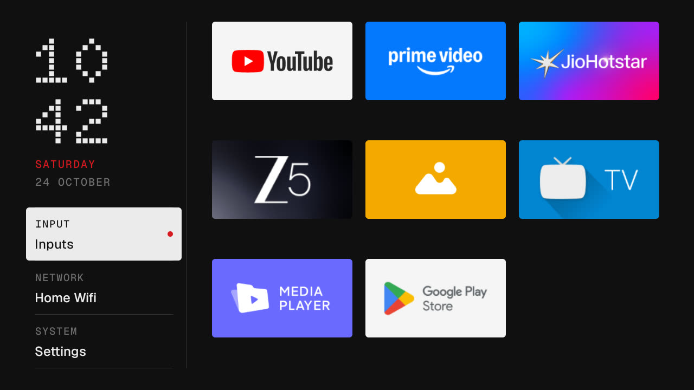
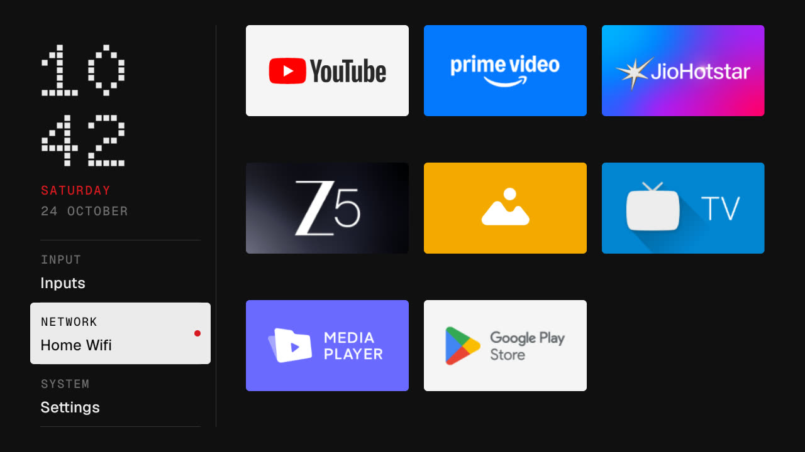
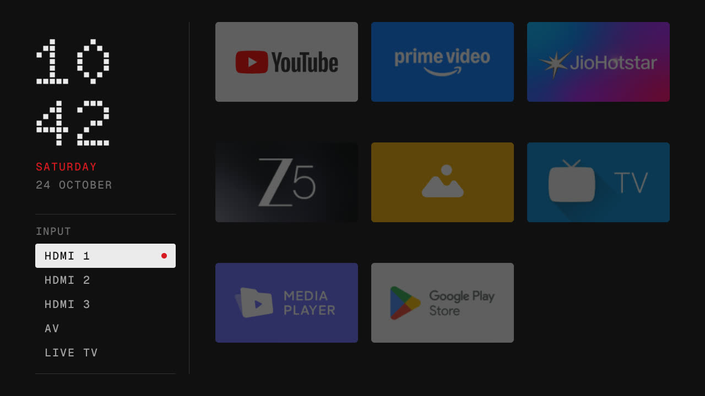
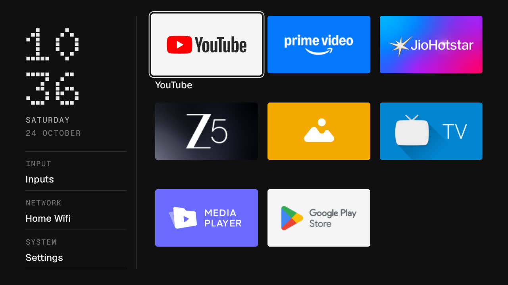

# Nothing-style TV launcher

A home screen for Android TV in the Nothing OS design language: an index, not a storefront.
Built for a 1 GB Xiaomi Mi TV 4A, where it runs in about 20 MB. One Java activity, one
RecyclerView, no network permission, no background services, no ads, no recommendations.



Made after [CleanYourTV](https://cleanyour.tv/) showed how: back up, disable the bloat with
`pm disable-user` (nothing uninstalled), install your own Home. This repo is that, plus a
launcher designed from Nothing's own guidelines rather than Apple's.

## What it looks like

A rail on the left, the apps on the right.

- **The clock** is Doto, Nothing's dot-matrix face, stacked as hours over minutes. It is the only
  place the dot face is used: at 720p from the sofa, dot type is legible only at display sizes,
  which is the same split Nothing arrived at in OS 3.0.
- **Three readouts** under the clock, each a mono label over a value between hairlines:
  **Input** (the connected source, or the list of inputs), **Network** (the Wi-Fi name, Ethernet
  or Offline) and **System** (Settings). The focused readout inverts to a rounded white block and carries the red dot.
- **The apps** as 16:9 banners in three columns, pinned apps first, the rest by name. Focus is
  a single white outline and a 1.08 scale; the name appears under the focused tile only.
- **The input list** expands in place inside the Input readout: HDMI 1 to 3, AV and Live TV.
  The red dot marks the focused row, the focused readout, and any input whose device the TV
  reports as on. The only other red is the weekday under the clock.
- Seven colours, three fonts (Doto Bold, Geist Medium, Geist Mono Medium), 1 dp hairlines,
  4.5 dp radii, no glow, no blur, no gradients, no glass. Every colour, size and timing is a
  token in `colors.xml`, `dimens.xml` and `Motion.java`.

| Network focused | Input list open | Grid focused |
|---|---|---|
|  |  |  |

The research, principles, both concepts and the design system are in
[design/proposal.md](design/proposal.md), with the HTML mockups in [design/mockups](design/mockups).

## The remote

- **Up / Down** move one row, **Left / Right** one tile. Left from the first column enters the
  rail; Right from the rail returns to the tile you left. The grid scrolls one row at a time
  and the rail stays put.
- **OK** on a tile opens the app. OK on Input expands the list; on Network or System it opens
  the TV's settings.
- **Menu** on the remote opens the input list from anywhere. **1 to 9** open the app in that
  grid position.
- **Back** closes the list, otherwise returns to the first app. **Home** while on Home does the
  same. Coming back from an app lands on the tile you left.

## Install

You need ADB over the network on the TV (Settings → Device Preferences → About, press OK on
Build seven times, then Developer options → USB debugging), JDK 17 and the Android SDK
(platform 36, build-tools 36.1.0). The Gradle wrapper fetches the rest.

```bash
TV_HOST=192.168.1.50 ./build-install.sh
```

That builds the APK, installs it, grants the location permission Android 9 needs to show
the Wi-Fi name (location itself can stay off), sets it as Home and presses Home.

On many Android TV 9 sets the stock launcher has a higher HOME priority and keeps winning.
If Home still opens the old launcher, disable it (reversible, and `restore.sh` undoes it):

```bash
TV_HOST=192.168.1.50 tools/disable.sh com.google.android.tvlauncher com.google.android.tvrecommendations
```

`tools/disable.sh` logs what it disabled to `debloat-xiaomi-mi-tv-4a.txt` and refuses core
Android packages (settings, system UI, permission controller, package installer, Play
services, the TV input services and so on) outright.

## Debloat (optional)

`debloat-xiaomi-mi-tv-4a.txt` is the list of packages I disabled on a Mi TV 4A (MiTV4I,
Android TV 9) and have lived with: Xiaomi and Google telemetry, PatchWall's content and
promoted-install packages, the Xiaomi cleaner and MiLink, preloaded Play Movies, Play Games,
YouTube Music and Mi Music, plus my own choices (Google Assistant and Xiaomi firmware updates).
Every line is `pm disable-user --user 0`; nothing is uninstalled. For other sets, start from the
[CleanYourTV lists](https://github.com/Gathin23/cleanyourtv/tree/main/examples) instead.

Take a backup first (package lists and settings, so you can compare later):

```bash
TV_HOST=192.168.1.50 tools/tv.sh 'pm list packages -d; pm list packages' > packages-before.txt
```

## Undo everything

```bash
TV_HOST=192.168.1.50 ./restore.sh
```

Re-enables every package in the list (the stock launcher becomes Home again), sets Private DNS
back to the Android default and uninstalls this launcher. You can also re-enable one app from the
TV: Settings → Apps → See all apps → Show system apps → the app → Enable.

## Customise

- `launcher/app/src/main/res/values/config.xml`: `columns` (3 fits the rail), `dock_apps`
  (the pinned apps, in order, first in the grid), `hidden_apps`, `wallpaper_brightness`.
- `colors.xml`, `dimens.xml`, `Motion.java`: the tokens. Change one and rebuild.
- A wallpaper: push a JPG, PNG or WebP to
  `/sdcard/Android/data/com.clean.tvhome/files/wallpaper.jpg` and restart Home; it is dimmed to
  `wallpaper_brightness` so the type stays readable. Delete the file to go back to black.
- Switch network ADB off when you are done: Developer options → Revoke USB debugging
  authorisations, USB debugging off, reboot, then `tools/adb-closed.py <tv ip>` should say CLOSED.

## Known limits

- Tested on one TV: Xiaomi Mi TV 4A (MiTV4I), Android TV 9, 1280x720. Other panels get the
  same dp layout but have not been looked at.
- The red "connected" dot relies on the TV reporting an input state; I had no HDMI device to
  confirm it with. The input list still switches sources.
- Network opens whatever the TV answers the Wi-Fi settings intent with; on this firmware that
  is the main Settings screen.
- No touch, no pointer, no RTL, English only.

## Licence

MIT, see [LICENSE](LICENSE). The fonts are under the SIL Open Font License:
[Doto](https://github.com/oliverlalan/Doto) and [Geist / Geist Mono](https://github.com/vercel/geist-font),
copies in [launcher/font-licenses](launcher/font-licenses).

Nothing is a trademark of Nothing Technology Limited. This is a fan project that borrows the
design language; it is not made, endorsed or supported by Nothing.
