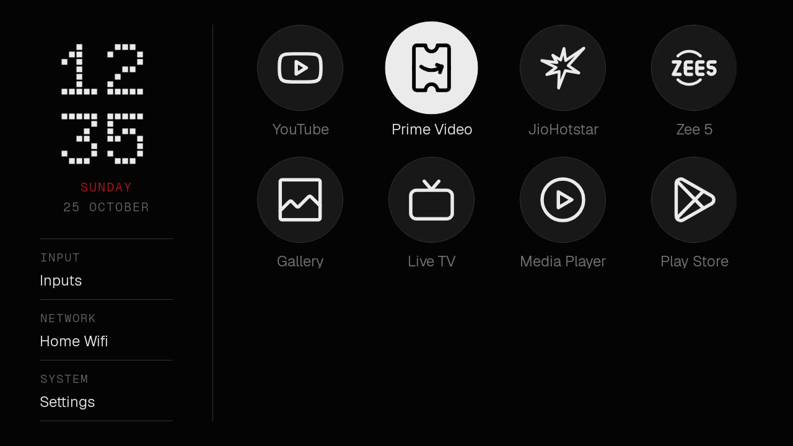
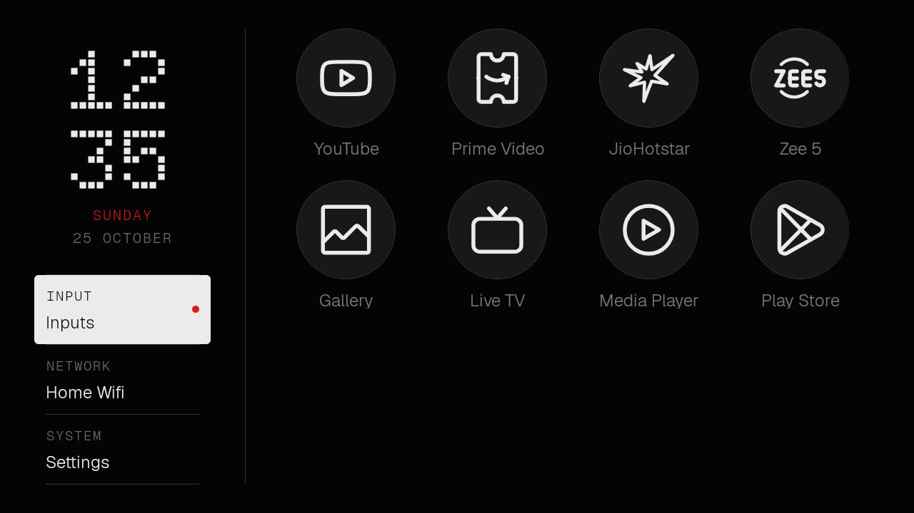
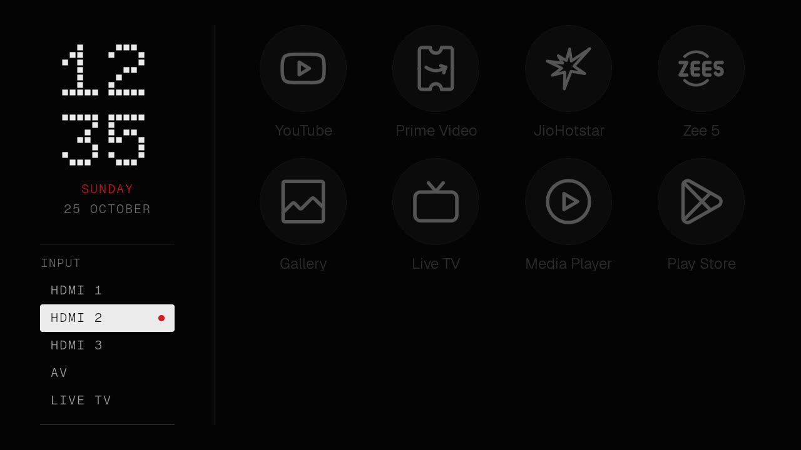
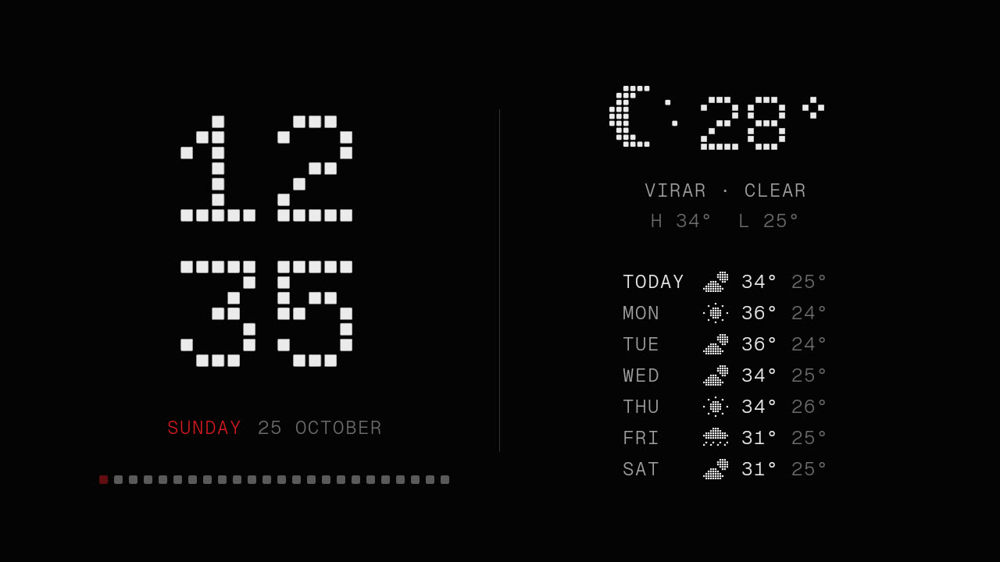

# Nothing-style TV launcher

A home screen and screensaver for Android TV in the Nothing OS design language: an index, not a
storefront. Built for a 1 GB Xiaomi Mi TV 4A, where it runs in about 24 MB. Plain Java, one
RecyclerView, no background services, no ads, no recommendations. Home never goes online; the
screensaver fetches the weather (see [Network use](#network-use)).



Made after [CleanYourTV](https://cleanyour.tv/) showed how: back up, disable the bloat with
`pm disable-user` (nothing uninstalled), install your own Home. This repo is that, plus a
launcher designed from Nothing's own guidelines rather than Apple's.

## What it looks like

A rail on the left, the apps on the right, on Nothing's own near-black.

- **The clock** is Doto, a dot-matrix face, stacked as hours over minutes, with the weekday in
  red and the date under it. The dot face is used only at display sizes: at 720p from the sofa,
  dot type is legible only that large, the same split Nothing arrived at in OS 3.0.
- **Three readouts** under the clock, each a mono label over a value between hairlines:
  **Input** (the connected source, or the list of inputs), **Network** (the Wi-Fi name, Ethernet
  or Offline) and **System** (Settings). The focused readout inverts to a rounded white block
  and carries the red dot.
- **The apps** as circles, four to a row, pinned apps first, the rest by name. Every app is drawn
  as a white line glyph from [Lawnicons](https://github.com/LawnchairLauncher/lawnicons), so all
  of them share one style; names sit under every circle, dimmed until focused. Focus inverts the
  circle (white disc, dark line) and scales it 1.08x.
- **The input list** expands in place inside the Input readout: HDMI 1 to 3, AV and Live TV.
  The red dot marks the focused row, the focused readout, and any input whose device the TV
  reports as on.
- Ground `#040404` and surface `#181818` (Nothing's dark-mode pair from nothing.tech), one red
  `#D71921`, three fonts (Doto Bold, Geist Light, Geist Mono Light), 1 dp hairlines, no glow, no
  blur, no gradients. Every colour, size and timing is a token in `colors.xml`, `dimens.xml` and
  `Motion.java`.

| Rail focused | Input list open | Screensaver |
|---|---|---|
|  |  |  |

The research, principles, both concepts and the design system are in
[design/proposal.md](design/proposal.md), with the HTML mockups in [design/mockups](design/mockups).
The built design is Concept B, refined since.

## The screensaver

"Nothing clock", fixed in place:

- **Left half:** the large dot clock, the red weekday and the date, the day as 24 dots (past
  hours lit, the current hour red and dimming once a second) and the input line while a device
  is on.
- **Right half**, after a hairline: the weather now (dot-matrix icon, temperature, place, sky,
  today's high and low) and the next seven days. With no weather reading yet, the right half
  hides and the clock centres.

`build-install.sh` doesn't switch screensavers. Pick "Nothing clock" in Settings → Device
Preferences → Screen saver, or:

```bash
TV_HOST=192.168.1.50 tools/tv.sh 'settings put secure screensaver_components com.clean.tvhome/.ClockDream'
```

To see it now: `TV_HOST=192.168.1.50 tools/tv.sh 'am start -n com.android.systemui/.Somnambulator'`.

## The remote

- **Up / Down** move one row, **Left / Right** one tile. Left from the first column enters the
  rail; Right from the rail returns to the tile you left. The grid scrolls one row at a time
  and the rail stays put.
- **OK** on an app opens it. OK on Input expands the list; on Network or System it opens the
  TV's settings.
- **Menu** on the remote opens the input list from anywhere. **1 to 9** open the app in that
  position.
- **Back** closes the list, otherwise returns to the first app. **Home** while on Home does the
  same. Coming back from an app lands on the app you left.

## Install

You need ADB over the network on the TV (Settings → Device Preferences → About, press OK on
Build seven times, then Developer options → USB debugging), JDK 17 and the Android SDK
(platform 36, build-tools 36.1.0). The Gradle wrapper fetches the rest.

```bash
TV_HOST=192.168.1.50 ./build-install.sh
```

That builds the APK, installs it, sets it as Home and presses Home.

On many Android TV 9 sets the stock launcher has a higher HOME priority and keeps winning.
If Home still opens the old launcher, disable it (reversible, and `restore.sh` undoes it):

```bash
TV_HOST=192.168.1.50 tools/disable.sh com.google.android.tvlauncher com.google.android.tvrecommendations
```

`tools/disable.sh` logs what it disabled to `debloat-xiaomi-mi-tv-4a.txt` and refuses core
Android packages (settings, system UI, permission controller, package installer, Play
services, the TV input services and so on) outright.

## Debloat (optional)

`debloat-xiaomi-mi-tv-4a.txt` is the list of packages I disabled on a Mi TV 4A (MiTV4I,
Android TV 9) and have lived with: Xiaomi and Google telemetry, PatchWall's content and
promoted-install packages, the Xiaomi cleaner and MiLink, preloaded Play Movies, Play Games,
YouTube Music and Mi Music, plus my own choices (Google Assistant and Xiaomi firmware updates).
Every line is `pm disable-user --user 0`; nothing is uninstalled. For other sets, start from the
[CleanYourTV lists](https://github.com/Gathin23/cleanyourtv/tree/main/examples) instead.

Take a backup first (package lists and settings, so you can compare later):

```bash
TV_HOST=192.168.1.50 tools/tv.sh 'pm list packages -d; pm list packages' > packages-before.txt
```

## Undo everything

```bash
TV_HOST=192.168.1.50 ./restore.sh
```

Re-enables every package in the list (the stock launcher becomes Home again), sets Private DNS
back to the Android default, puts the screensaver back to Google's Backdrop and uninstalls this
launcher. You can also re-enable one app from the TV: Settings → Apps → See all apps → Show
system apps → the app → Enable.

## App icons

About 10,000 glyphs from [Lawnicons](https://github.com/LawnchairLauncher/lawnicons) cover some
14,000 apps. Each app is matched by a TV alias, then its activity, its package, its name, a word
in its name (Gallery, Settings, Player, TV...), and finally its initial letter in the same line
style; an app with no Latin letter in its name shows its name in the circle. Of 71 popular
Android TV apps, 64 get a real glyph.

- `tools/lawnicons-tv.txt` holds what Lawnicons lacks for TVs: aliases for TV builds of
  streaming apps, words for brand-specific system apps, and a TV glyph of our own.
- `tools/lawnicons.py` turns a Lawnicons checkout into the two text assets the launcher draws
  from (path data, not 10,000 drawables):

```bash
git clone --depth 1 https://github.com/LawnchairLauncher/lawnicons.git /tmp/lawnicons && tools/lawnicons.py /tmp/lawnicons launcher/app/src/main/assets
```

The TV remembers which glyph each app got and only searches again after an app is installed,
removed or renamed, or the launcher is updated (about a second, once; 50 ms otherwise).

## Network use

Home never goes online. The screensaver's weather is the launcher's only use of the internet,
which is why it holds the `INTERNET` permission:

- [Open-Meteo](https://open-meteo.com) (free, no key, no account) for now and eight days, at
  most every 30 minutes and only while the screensaver is on. The last reading is kept, so it
  shows at once and offline; it is hidden after three hours.
- To know where you are, the city of the TV's internet address from ipapi.co, once a week.
  To skip that lookup, set `weather_latitude`, `weather_longitude` and `weather_place` in
  `config.xml`.

No analytics, no accounts, nothing else.

## Customise

`launcher/app/src/main/res/values/config.xml`:

- `tile_shape`: `circle` (line glyphs, the default) or `banner` (the apps' own 16:9 banners,
  three to a row, with an outline for focus); `circle_columns` and `columns` set how many fit a row.
- `dock_apps`: the pinned apps, in order, first in the grid. `hidden_apps`: never shown.
- `weather_latitude`, `weather_longitude`, `weather_place`, `weather_unit` (`celsius` or
  `fahrenheit`).
- `wallpaper_brightness`, for a wallpaper pushed to
  `/sdcard/Android/data/com.clean.tvhome/files/wallpaper.jpg` (restart Home; delete it to go
  back to the plain ground).

`colors.xml`, `dimens.xml`, `Motion.java` hold the tokens. Change one and rebuild.

Switch network ADB off when you are done: Developer options → Revoke USB debugging
authorisations, USB debugging off, reboot, then `tools/adb-closed.py <tv ip>` should say CLOSED.

## Known limits

- Tested on one TV: Xiaomi Mi TV 4A (MiTV4I), Android TV 9, 1 GB RAM, 1280x720. Other panels
  get the same dp layout but have not been looked at.
- The red "connected" dot relies on the TV reporting an input state; I had no HDMI device to
  confirm it with. The input list still switches sources.
- Network opens whatever the TV answers the Wi-Fi settings intent with; on this firmware that
  is the main Settings screen. On Android 10 and later the readout says "Wi-Fi" rather than the
  network's name, which those versions only reveal with location access.
- No touch, no pointer, no RTL, English only.

## Licence

MIT, see [LICENSE](LICENSE).

- App glyphs: [Lawnicons](https://github.com/LawnchairLauncher/lawnicons), Apache-2.0, licence in
  [launcher/app/src/main/assets/lawnicons/LICENSE](launcher/app/src/main/assets/lawnicons/LICENSE).
- Fonts: [Doto](https://github.com/oliverlalan/Doto) and [Geist / Geist Mono](https://github.com/vercel/geist-font),
  SIL Open Font License, copies in [launcher/font-licenses](launcher/font-licenses).
- The weather icons in `DotMatrix.java` were drawn for this launcher. The screensaver can also use
  other `sanyaas_*` drawables if a build adds them; none ship here.

Nothing is a trademark of Nothing Technology Limited. This is a fan project that borrows the
design language; it is not made, endorsed or supported by Nothing.
