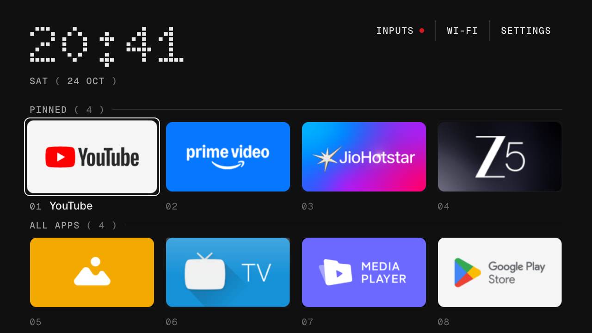
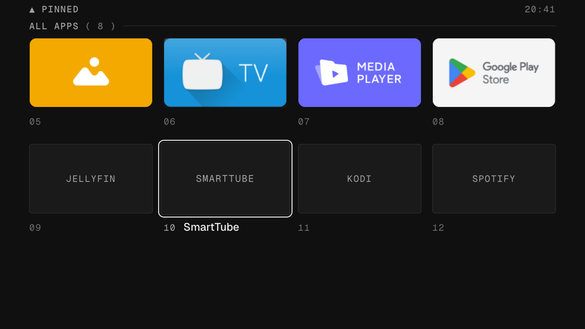
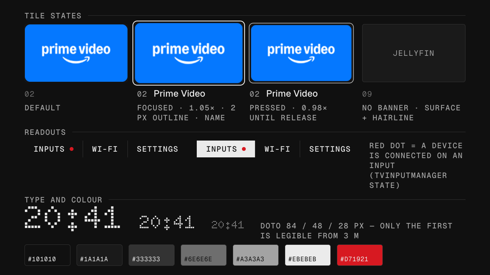
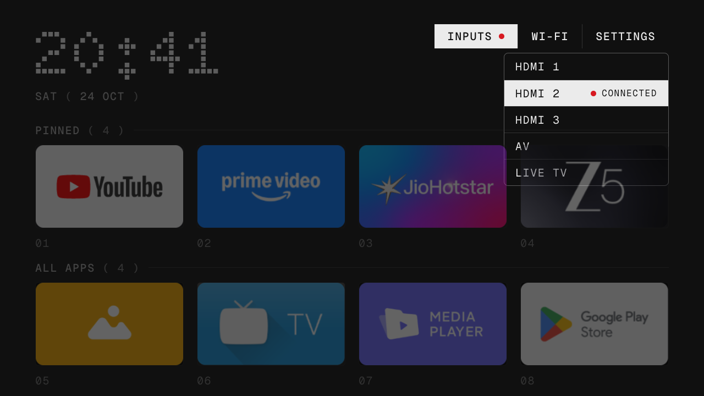
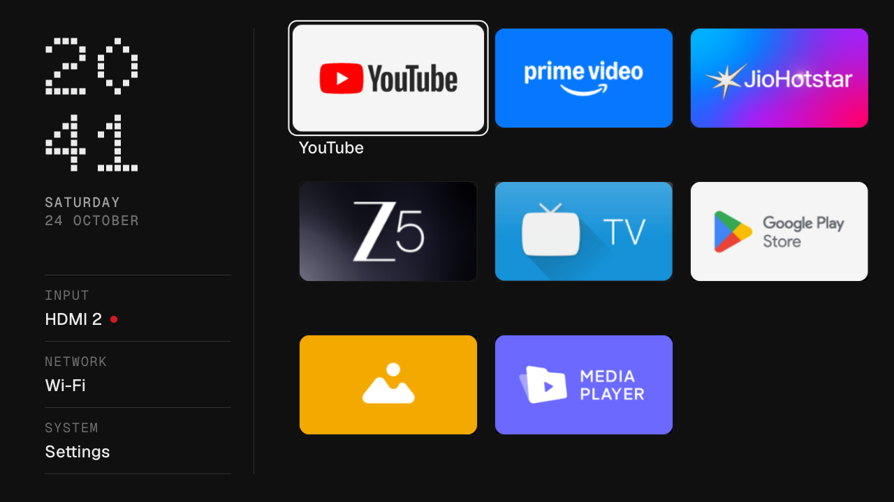
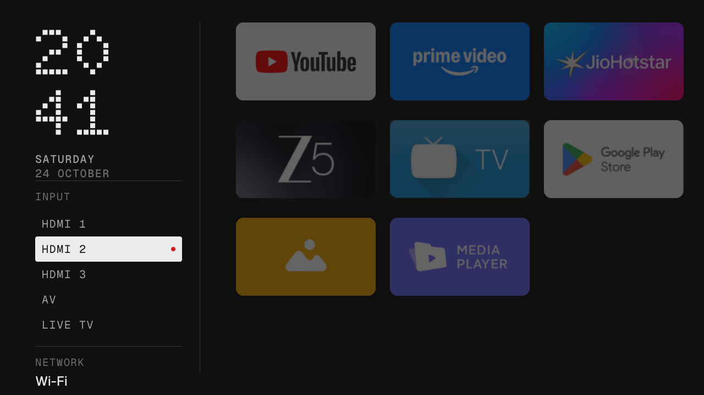

# A Nothing TV launcher: design proposal

The design phase of this project: research-first, written before any code was changed. Concept B, "Panel", is what was built; the launcher in `../launcher` follows section 2 and the Concept B mockups, with the design system from section 4 as its tokens. The mockups are in [mockups/](mockups/), as editable HTML and 1280x720 PNG (the TV's real pixel size).

Provenance tags used below, as the brief asked: **[Observed]** directly seen in Nothing's products or stated by Nothing; **[Adapted]** a Nothing principle carried to the TV; **[New]** a proposal inspired by the wider philosophy. Every number in the design system is a recommendation, not a Nothing specification: Nothing publishes none.

## Summary

If Nothing designed a television, the launcher would be an **index, not a storefront**: the owner's apps and the TV's own inputs, laid out like a diagram, with a dot-matrix clock as the single moment of brand recognition and one red dot carrying state. The recommended direction is **Concept A, "Index"**: a static page with a numbered grid of 16:9 banners under hairline section rules, three mono-type readouts top right (Inputs, Wi-Fi, Settings), no hero, no rows of content, no glass, no glow.

Three findings from the research decide this:

1. Nothing's own software rule is "widgets became controls rather than decoration" and a home screen should not be "a collection of company logos"; the launcher therefore shows apps *as an index* (numbered, labelled, sectioned) rather than as logos floating on black.
2. Nothing removed its dot font from body text in OS 3.0 for readability, got a revolt, and conceded it "went a bit too hard". At 720p from 3 m, dot type is only legible above roughly 40–48 px, so the dot face belongs to the clock and nowhere else: the same split Nothing arrived at.
3. The Mi TV 4A is Google's 1 GB low-RAM tier: no blur, no parallax, no layered compositing. Nothing's own web layer (1 px hairlines, 6–8 px radii, no gradients or glass) is exactly the vocabulary that hardware can afford, so hardware honesty and brand fidelity point the same way.

Concept B, "Panel", is a genuinely different hypothesis (an instrument rail of readouts with apps beside it) and is kept as the alternative for a TV used mostly through HDMI devices.

## 1. Design principles, in priority order

1. **Every visible element is a control or a readout.** No decoration that is not a state. [Observed: "functional aesthetics"; "widgets became controls rather than decoration".]
2. **Apps and inputs are the object. Nothing is sold on the home screen.** No hero, no recommendations, no sponsored tiles. [Adapted from Nothing's bloat-free OS and the Apple Top Shelf rule "avoid showing advertisements"; supported by Hub 2024: 50% open a specific app, 47% never add apps.]
3. **Dots where they are recognised, clean type where things are read.** Dot-matrix only for the clock at display size; a grotesk for names; uppercase mono for labels. [Observed: the 2021 type system and the OS 3.0 reversal; conversion: dot type needs 3–4 px dots, so 40–48 px and up.]
4. **Monochrome chrome, one red point, colour arrives through content.** App banners are the only colour; red marks exactly one state. [Observed: Hoyss on red; Phone (3) recording light; Weather's red data values.]
5. **Hairline geometry.** 1 px rules, 6 px radii, flat fills, outlines rather than glows. No pills, gradients, blur or glass. [Observed on nothing.tech (unofficial audit); required by the 1 GB memory tier.]
6. **Honest to the panel.** Every size comes from the 720p / 3 m numbers: 19 px text floor, Regular or Medium reading weights, colours inside RGB 16–235, 64/40 px safe margins. [Adapted: Nothing lets the engineering dictate the surface.]
7. **One focus, deterministic, remembered.** Exactly one focused item; it moves only on a key press, one step per press; the launcher returns to where you left it. [Observed: Android, Apple and Samsung guidelines; already true of the existing launcher.]
8. **One toy per surface.** The clock is the playful element: it can form from scattered dots once on wake. Nothing else animates at idle. [Adapted: Glyph Toys, "injecting fun into a boring industry", the Dot Engine.]
9. **The owner edits it in a text file, not a settings maze.** Pinned apps, columns, hidden apps stay in `config.xml`. [Adapted: Nothing OS 4.0's "distract less" after 3.0's "customization"; the existing launcher's convention.]
10. **Nothing's marks stay Nothing's.** Open-licence stand-ins for the typefaces, no wordmark, no "(1)"-style product naming of the launcher itself. [Fact: NDot is licensed exclusively to Nothing.]

## 2. Proposed design direction

### 2.1 Visual language

| Element | Proposal | Why | Provenance |
|---|---|---|---|
| Ground | `#101010`, flat, no wallpaper by default | RGB 16 is video black: no LCD bloom around white text, no black crush of hairlines. Nothing's standard dark mode is dark grey; true black is its opt-in "Extra Dark". | Adapted |
| Surfaces | `#1A1A1A` for banner-less tiles and panels, always with a 1 px `#333333` hairline | Nothing's dialog "relies on its border alone"; a fill plus a line reads from 3 m where a fill alone does not. | Observed (web) → Adapted |
| Primary text | `#EBEBEB` Geist Medium | RGB 235 is video white; Medium because Apple and Google both ban thin weights on TV. | Adapted |
| Secondary text | `#A3A3A3` (7:1 on ground) for labels; `#6E6E6E` only for index numerals, never for words | WCAG AAA for anything read; the dimmer grey stays above the inferred black-crush threshold. | Adapted |
| Display type | Doto (OFL, Google Fonts) for the clock only, 112 px | Stand-in for NDot, which is licensed exclusively to Nothing. 112 px gives 7-row dots of about 8 px with clear gaps: legible at 3 m. Never used below 84 px. | Observed role, substitute face |
| Reading type | Geist (OFL) for app names, 24 px Medium | Geist is Nothing OS 4.0's actual system face, and it is open-licence. | Observed |
| Label type | Geist Mono (OFL), 20 px, uppercase, +0.08 em | Nothing uses uppercase mono for small labels on the web (Lettera Mono) and Geist Mono in Playground. 20 px is the 720p floor. | Observed |
| Numbers | Two-digit index `01…` on every tile; counts in parentheses `( 4 )` | The subway map and "(1)" naming are Nothing's two portable motifs; numbering is also an affordance (press 1–9 on remotes that have digits). | New, from Observed motifs |
| Icons | The app's own 16:9 banner, 6 px radius, no border; banner-less apps get the surface + hairline + mono name | Banners are each app's identity; forcing monochrome would hide what the viewer is looking for. Nothing's monochrome pack is opt-in, not default. A monochrome toggle can come later. | Adapted |
| Spacing | 8 px unit; 64 px sides / 40 px top and bottom; 24 px gutter | Nothing's web unit is 8 px; 64/36 px is the 5% TV safe area (40 px rounds to the unit). | Adapted |
| Geometry | Section rules: 1 px hairline with the label sitting on the line, like a callout on a drawing; tiles 6 px; panel 8 px; no pills anywhere | "Diagram, not decoration" is the organising idea behind every Nothing motif. | New, from Observed |
| Accent | `#D71921` (the circulating approximation of Nothing red) as a 10 px dot only | It marks one state: an input has a device connected (`TvInputManager` reports this). It is never a fill, a focus colour or a surface. | Adapted |
| Focus | Tile: scale 1.05×, 2 px `#EBEBEB` outline inset 6 px outside the art, name appears beside the index. Readout: inverted (white fill, black text). Panel row: inverted. | Google's 1.05 default; Apple's "label appears on focus"; Nothing's black/white button pair gives the invert. Three legible styles (scale, border, invert) and the viewer never sees more than one focused thing. | Adapted |
| Motion | Focus 150 ms, row scroll 250 ms, panel 200 ms, all `cubic-bezier(.2,0,0,1)`. Pressed: 0.98× until release. Optional: clock forms from dots once on wake, 400 ms. No idle animation. | Leanback and Material durations; the Dot Engine as the one brand gesture; Ambient Mode must not be blocked. | Adapted |
| Hierarchy | Clock → focused app name → banners → section labels → index numbers | One big readout and one answer to "where am I", everything else recedes. | Adapted ("few elements, each dense") |

### 2.2 Information architecture

| Content | Decision | Reason |
|---|---|---|
| Pinned apps (4–6) | **Prominent**, first row, numbered 01– | 50% of viewers open a specific app; Nothing's own dock holds five. |
| All other apps | **Prominent**, second section, numbered on, alphabetical | 47% never add apps after setup, so the full list fits on one screen for most owners; it scrolls one row per press when it does not. |
| Time and date | **Prominent**, the one glanceable readout | The only data the TV holds that is worth a display face. |
| Inputs | **Prominent as a readout**, one press away; red dot when a device is connected | A TV is a box of inputs; every platform has moved inputs off the home surface, which users resent. The remote's unused Menu button opens the same panel. |
| Network | **Secondary readout** ("Wi-Fi" / "Ethernet" / "Offline") | A status, not a destination. Shows the SSID only if the owner enables location. |
| Settings | **Secondary readout** | Needed, not featured. |
| Recently used | **Excluded** | With eight apps it adds nothing; usage data needs a permission and a service. |
| Continue watching / recommendations | **Excluded** | Praised on Google TV, but it needs provider feeds the launcher does not have, and it is the exact row the ad banner was bolted to. Revisit only if a provider-neutral source exists. |
| Search | **Excluded** | 38 D-pad keystrokes for "hey there"; voice is disabled on this set. |
| Weather, profile, "For you" | **Excluded** | Network polling, accounts, or inventory. |

### 2.3 Interaction model

- **Directional.** Up and Down move exactly one row; Left and Right move one tile and stop at the ends; nothing wraps and nothing falls through to another zone sideways. The top row is the three readouts. Up from the pinned row goes to the readout above the current column. Down from the last row does nothing.
- **Focus.** One item, three cues (scale, outline, name). The outline is drawn by the existing single highlight view, so a fast run of presses animates one object and never leaves two tiles lit. Every press is honoured even mid-animation; the highlight retargets, it does not queue.
- **Select.** Pressed state (0.98×) while the key is down; launch on release. Readouts: Inputs opens the panel under itself; Wi-Fi and Settings open the system screens.
- **Panel.** Opens in 200 ms under the Inputs readout, rows 48 px, the connected input marked with the red dot; Up/Down move within it; Select switches input; Back or Left/Right closes it and returns focus to the Inputs readout.
- **Back.** Closes a panel, otherwise returns to pinned 01. Back never leaves Home.
- **Home while on Home.** Returns to pinned 01, like a second press of the Apple TV button.
- **Menu button** (currently unused on the remote). Opens the Inputs panel directly: one physical control for the TV's physical sockets.
- **Long-press Select.** Reserved for a future "move / pin / hide" action, the gesture every platform shares. Not in the first implementation; `config.xml` does that job.
- **Number keys** (on remotes that have them). 1–9 open the app with that index.
- **Timing.** 150 ms focus, 250 ms row scroll, 200 ms panel, 400 ms clock reveal once on resume; nothing longer; nothing at idle.
- **Memory of place.** Zone and index persist across launches, as today; after an app list change, focus clamps to the nearest valid item rather than jumping to the top.

## 3. Mockups

All at 1280x720, the TV's panel, with the real app banners cropped from the TV's own screenshots so the concepts are judged against actual colour.

### Concept A, "Index" (recommended)

**A1. Home.** Dot clock and date top left; Inputs / Wi-Fi / Settings as hairline-separated mono readouts top right, with the red dot showing a device is connected; "PINNED ( 4 )" and "ALL APPS ( 4 )" as callout rules; eight numbered banners; focus on 01 YouTube.

**A2. Browsing all apps** (twelve apps installed, scrolled one row). The top band has left the screen; a 40 px strip keeps "▲ PINNED" and the time; banner-less apps appear as surface + hairline + mono name; focus on 10 SmartTube.

**A3. Component states.** Tile default / focused / pressed / no-banner; readouts default and focused (inverted); the dot face at 84, 48 and 28 px to show why only display size works; the seven colours.

**A4. Inputs panel.** Opens under the readout, 300 px wide, 48 px rows, hairline-bordered on the ground colour; the page behind dims to 35%; HDMI 2 is focused and carries "● CONNECTED".

### Concept B, "Panel" (alternative)

Hypothesis: the launcher is an instrument panel. A 300 px rail on the left holds the stacked dot clock, the date and three readouts (Input, Network, System) as labelled values with hairline separators, always visible and focusable; apps sit to the right in three columns of 256x144 banners, unnumbered, with the name on focus. Left from the first column enters the rail.

**B1. Home.**

**B2. Rail focused, input list expanded in place.**

### A versus B

| | A, Index | B, Panel |
|---|---|---|
| What it says the TV is | A list of things you open | A device with sockets and a status |
| Apps visible without scrolling | 8 (4 columns) | 9 (3 columns), larger tiles |
| Readouts | Three text buttons, one row | Always-visible labelled values, "widget"-like |
| Presses to switch input | 2 up + 1 select + 1–4 down + select | 1 left + 1–2 down + select |
| Presses to open pinned 02 from idle | 1 right + select | 1 right + select |
| Fits the existing code | Restyle of existing zones | Needs a new rail zone and 3-column grid |
| Risk | Can look like a table | Rail steals 25% of width from the apps; the clock splits in two |
| Best for | Streaming-first owners (this TV) | Owners who live on HDMI devices |

Recommendation: A, because the evidence (50% open a specific app; apps-first grids are what users praise) favours apps over readouts, and because B's rail is the one place the design starts to resemble Tizen and webOS side rails rather than Nothing.

## 4. Initial design system (recommendations)

**Colour**

| Token | Value | Use | Contrast on ground |
|---|---|---|---|
| `ground` | `#101010` | background | — |
| `surface` | `#1A1A1A` | banner-less tiles, panels | — |
| `hairline` | `#333333` | rules, tile outlines | — |
| `hairline-strong` | `#5A5A5A` | panel border | — |
| `text` | `#EBEBEB` | names, readouts, clock | 15.1:1 |
| `text-2` | `#A3A3A3` | labels, date | 7.1:1 |
| `text-3` | `#6E6E6E` | index numerals only | 3.5:1 |
| `accent` | `#D71921` | the input-connected dot only | n/a |

**Type (px at 720p; sp = px ÷ 1.333)**

| Role | Face | Size | Weight | Case |
|---|---|---|---|---|
| Clock | Doto | 112 (84 sp) | 700 | numerals |
| App name (focused) | Geist | 24 (18 sp) | 500 | as supplied |
| Readouts, section labels, panel rows, date | Geist Mono | 20 (15 sp) | 500 | upper, +0.08 em |
| Index numerals | Geist Mono | 20 (15 sp) | 500 | — |
| Floor | — | 19 px (14 sp) | — | nothing below this |

**Spacing and grid**

| Token | Value |
|---|---|
| Unit | 8 px |
| Safe margin | 64 px sides, 40 px top and bottom |
| Content width | 1152 px |
| Columns | 4 (configurable 4–6) |
| Gutter | 24 px |
| Tile (4 col) | 270 x 152 px, 16:9 |
| Tile (5 col) | 211 x 119 px |
| Tile (6 col) | 172 x 97 px (minimum before banners stop reading) |
| Caption row | 30 px, 14 px above |
| Section rule to tiles | 26 px |
| Row to row | 36 px |
| Readout height | 44 px, 24 px side padding |
| Panel | 300 px wide, 48 px rows, 20 px padding |

**Geometry and focus**

| Token | Value |
|---|---|
| Tile radius | 6 px |
| Panel radius | 8 px |
| Hairline | 1 px |
| Focus outline | 2 px `text`, 6 px outside the art, radius 12 px |
| Focus scale | 1.05× (tiles), none (readouts: invert) |
| Pressed | 0.98× while key down |
| Focus growth allowance | 7 px per side at 1.05×, inside the 24 px gutter |

**Motion**

| Transition | Duration | Easing |
|---|---|---|
| Focus move | 150 ms | `cubic-bezier(.2,0,0,1)` |
| Name reveal | 150 ms | linear fade |
| Row scroll | 250 ms | same curve |
| Panel open / close | 200 ms | fade + 0.96→1 scale |
| Clock reveal on resume (optional) | 400 ms | dots settle, once |
| Idle | none | — |

**Component states**

| Component | Default | Focused | Pressed | Unavailable |
|---|---|---|---|---|
| Tile | banner, index `text-3` | 1.05×, outline, name, index `text-2` | 0.98×, outline `text-2` | surface + hairline + mono name |
| Readout | `text` on ground | inverted | inverted, 0.98× | hidden if the feature is absent |
| Panel row | `text` on ground, hairline above | inverted | inverted | — |

Consistency comes from three constraints rather than many tokens: every line is 1 px `hairline`, every piece of small text is 20 px uppercase mono, and every focus is "scale + outline + name" or "invert". A new element either fits one of those three or does not belong.

## 5. Design rationale: the decisions that matter

1. **No hero, no content rows.** Every ad-funded platform moved apps below promotional rows between 2022 and 2026 and users attack it on all of them; Apple's HIG bans ads in Top Shelf; Hub's data says half of viewers go straight to an app. Nothing's "we can't be everything for everybody" licenses the omission. The cost is losing "Continue Watching", the one praised row, which this launcher cannot source anyway.
2. **Dot type only for the clock.** Nothing's own 2024 reversal and the signage legibility numbers (5x7 minimum matrix, 3–4 px dots at 3 m) agree: the dot face is the brand at display size and a readability failure below it. The existing launcher's 68 sp ExtraLight clock breaks the Apple/Google weight rule; the dot clock replaces it at the same hierarchy level.
3. **Index numbers and callout rules instead of a glow and a title.** The existing design borrows Apple TV's sampled-colour glow and large title. Nothing's motifs are diagrams (subway map, exposed board, "(1)"). Numbering the tiles and labelling the sections with rules reads as a schematic of the TV's contents and gives the remote something to address.
4. **Invert for readouts, outline for tiles.** Nothing's web buttons are black-on-white / white-on-black pairs; a filled inversion is the most legible focus style from 3 m and needs no colour. Tiles cannot invert (they are pictures), so they get the border style plus a 1.05× scale, the two other legible styles.
5. **Red as a readout.** The dot is the only place red appears and it means one thing: a device is plugged into an input. That is the Phone (3) recording light and Weather's red data values transferred, not a "brand colour" splashed on focus rings.
6. **Ground at RGB 16, not 0.** Nothing's standard dark mode is grey; true black is its opt-in. On this LCD, pure black invites bloom around white text and swallows hairlines. The 16–235 range is also the honest range of the video signal the TV exists to show.
7. **Keep the app banners in colour.** The brief asks how monochrome chrome coexists with colourful icons. The answer from Nothing's own products is that colour is content: photography on the website, app icons in the drawer unless the owner opts into the icon pack. Banners stay as supplied; the chrome around them is so quiet that they become the only colour on screen, which is the Nothing website in miniature.

## 6. Critical evaluation

| Criterion | Concept A | Notes |
|---|---|---|
| Reflects Nothing's philosophy | Strong | Functional aesthetics, dots at recognition, mono labels, red point, hairlines, one toy. Weak spot: no transparency motif, which has no honest TV equivalent. |
| Purpose-built for television | Strong | Every size from 10-foot rules; 16:9 banners; one focus; safe margins. |
| Readable at 3 m | Strong | Nothing below 19 px, Medium weights, 7:1 labels. The dim `#6E6E6E` index numerals are deliberately sub-threshold and must never carry words. |
| Predictable remote navigation | Strong | One step per press, clamped ends, Back to 01; inherits the existing deterministic model. |
| Avoids clutter | Strong | 8 tiles, 3 readouts, 1 clock. |
| Apps easy to discover | Good | Everything visible on one screen up to 8 apps; alphabetical beyond. No search is a real loss for owners with 30 apps. |
| Minimal yet usable | Good | Two things need testing on the set: whether "PINNED / ALL APPS" rules read as sections or as table lines, and whether index numerals feel useful or fussy on a remote without digits. |
| Distinctive with colourful banners | Good | The quiet chrome makes banners the colour; but with eight saturated banners the screen is busier than any Nothing phone screen. A monochrome banner toggle (desaturate + hairline) is the obvious option to add. |
| Depends on decorative branding | Low | One dot clock, one red dot, parentheses in two labels. Remove the clock and it is still a usable launcher, which is the right test. |
| Original vs borrowed | Mixed | Borrowed: 16:9 banner grid (Android TV), label-on-focus (Apple), invert focus (Smashing's three styles). Original: numbered index with callout rules, red as connected-input state, readouts as text instruments, Menu button to inputs. |

**Weaknesses and improvements**

- *It can look like a spreadsheet.* The rules and numbers are the identity but also the risk. Mitigation: keep index numerals at `text-3`, keep only two rules on screen, and let the clock be large.
- *Doto is not NDot.* Doto's dots are rounder and its numerals wider; the clock will read as "dot-matrix", not as "Nothing's dot-matrix". That is correct legally and should be said plainly in any write-up.
- *The one-page claim fails past 8 apps.* The scrolled state (A2) is plainer than the home state; the pinned strip at the top is the only orientation. Worth testing with 12+ apps on the device.
- *No monochrome option at launch.* Nothing's identity includes the opt-in monochrome pack; a desaturated-banner mode is cheap (a colour matrix on the ImageView) and should be the first follow-up.
- *The red dot needs real data.* `TvInputManager` input states on this Amlogic firmware must be verified to change when a device is plugged in; if they do not, the dot must go rather than lie.

**Trade-offs that are genuinely open**

- *Four columns versus five.* Four gives 270 px banners that read from 3 m; five fits ten apps without scrolling at 211 px, near the floor for banner text. The config already allows both.
- *Name on focus only versus always.* Nothing hides icon labels as an option and Apple shows labels on focus; always-on names at 20 px would add 8 words to the screen. Focus-only is proposed; always-on is a one-line change.
- *Concept B's rail.* It is the more "widget" reading of Nothing and the better TV for HDMI users, at the price of 25% width and a resemblance to Tizen/webOS rails.

## 7. Implementation considerations (for later; nothing done)

**Restyle only, no behaviour change** (all in the parts the assessment marked purely visual):

- `colors.xml`: the eight tokens above. `styles.xml`: replace pill styles with readout styles (no radius, hairline left border, invert on focus).
- Fonts: add Doto, Geist and Geist Mono (OFL) to `res/font`; drop Outfit. Use static TTF instances, not variable fonts, because API 26–28 variable-font support is uneven.
- `tile.xml` and `activity_home.xml`: radius 6 px, caption row with index + name, section rules with callout tags, readout bar, remove the glow view and the big title box. `sizeTiles()` constants (lines 206–216) must change in step with the XML.
- `GlassHighlight.java`: draw a 2 px outline with no fill or sheen; retarget duration 150 ms, standard easing instead of overshoot.
- Clock: Doto, 112 px, `HH:mm`; the optional dot-settle reveal is a 400 ms alpha/position animation of a pre-rendered dot layer, not per-frame drawing.
- Remove `sampleColor` glow use (keep the function for the banner-less tile fill, or drop it).

**Small functional additions**

- Index numerals: a `position + 1` label in the adapter; optional `KEYCODE_1`–`9` handling in `dispatchKeyEvent`.
- Inputs panel: restyle rows; add the connected state from `TvInputManager.getInputState(id)` (`STATE_CONNECTED`) and a `TvInputCallback` so the dot updates without polling. Verify on this firmware first.
- Menu button: map `KEYCODE_MENU` to `openMenu()`.
- Scrolled-state strip (A2): a fixed 40 px header outside the ScrollView, shown only when `scrollY > 0`.

**Must not change**

- The manifest, the opaque theme, the HOME intent filter and `<queries>`; the four-zone focus model and its saved preferences; `Apps.load`; the launch intent; the package, time and network receivers; the wallpaper mechanism; `config.xml` semantics; `build-install.sh`.

**Concept B would additionally need** a fifth zone (RAIL) in `move()`/`activate()`, a three-column grid, and a stacked clock view: a day's work rather than an afternoon.

**Order of work, if approved:** tokens and fonts → tile and readouts → clock → inputs panel and red dot → A2 strip → measure PSS and frame timing on the TV → monochrome toggle as a follow-up.

## 8. Decisions needed from you before any code

1. Concept A or Concept B.
2. Index numerals: keep, or drop in favour of names always shown.
3. The clock: Doto dot-matrix as proposed, or a plain Geist clock with the dot motif reserved for the optional reveal only.
4. Red dot: keep as "input connected" (subject to the firmware check), or omit red entirely.
5. Columns: four (proposed) or five.
